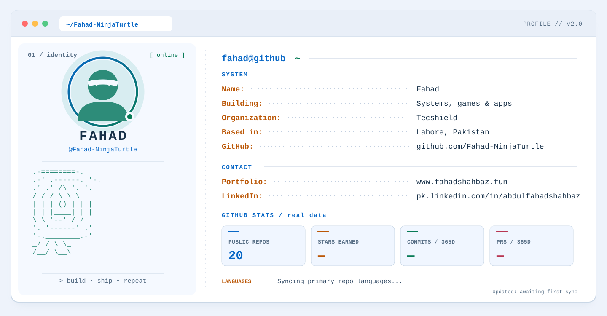

  <picture>
    <source media="(prefers-color-scheme: dark)" srcset="./assets/terminal-dark.svg">
    <source media="(prefers-color-scheme: light)" srcset="./assets/terminal-light.svg">
    
  </picture>

  <a href="https://www.fahadshahbaz.fun/">Website</a> &nbsp;•&nbsp;
  <a href="https://pk.linkedin.com/in/abdulfahadshahbaz">LinkedIn</a> &nbsp;•&nbsp;
  <a href="https://github.com/Fahad-NinjaTurtle?tab=repositories">Repositories</a>

<!--
  The terminal is a REAL standalone SVG image, not a table of Markdown text.
  GitHub's <picture> element selects the light/dark SVG automatically.
  SVGs include the GitHub avatar as a self-contained base64 image after sync.
  To refresh public GitHub stats/portrait: Actions -> Update terminal profile -> Run workflow.
  For configuration details, read SETUP.md.
-->
